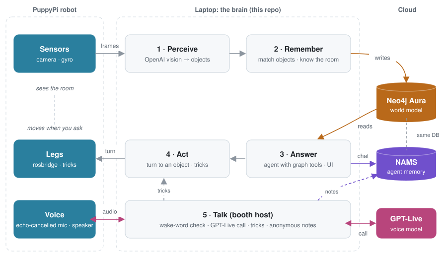
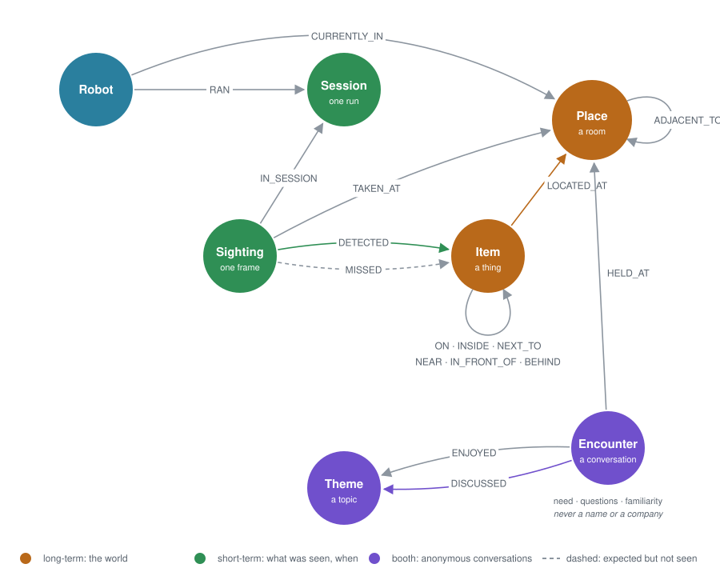
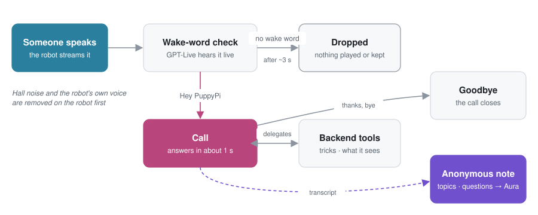

<p align="center"></p>

<h1 align="center">puppy-mind</h1>
<p align="center"><b>Talk with your environment.</b> Spatial memory and physical AI for the Hiwonder PuppyPi, on Neo4j.</p>

A small quadruped robot walks through your home and keeps looking. Every camera frame becomes structured facts (objects, where
they are, what sits on what), stored in a **Neo4j Aura** graph that remembers how the world changes over time. You can then ask it
questions in plain language, and an agent answers **only from that memory**, with timestamps and evidence. It can also turn to face
things it remembers. At a conference booth it becomes the **Graph Wizard**: visitors say "Hey PuppyPi" and talk with it about
Neo4j, GenAI and GraphRAG, and it keeps anonymous notes of what the booth talked about.

*Document intelligence is "talk to your PDF". Physical intelligence is "talk with your environment".*

> "What's on the table?" · "What changed since this morning?" · "Where did you last see the red backpack?" · "Turn to the cat."

---

## What it can do

| | You ask | What happens |
|---|---|---|
| **Perceive** | "What do you see?" | OpenAI vision turns a frame into objects, colours, zones and spatial relations |
| **Remember** | "What's on the table?" | Objects keep a stable identity across frames; relations (`ON`, `NEXT_TO`, ...) are temporal edges |
| **Notice change** | "What changed?" | New objects, things not seen any more (`possibly_gone`, never "deleted"), relations that ended |
| **Know where** | "Which rooms do you know?" | Rooms are recognised from what is in them; a room map is learned as the robot moves |
| **Explain** | "Where did you last see it?" | Every answer comes with the tool calls and graph facts it used |
| **Act** | "Turn to the door." · "Come here!" · "Take a nap." · "Run!" · "Stop!" | Turns in place to face a remembered object, or looks around for it. Between rooms it gives you the route. Walks, turns, sprints and does its tricks when you tell it to, in short moves (at most 4 s) and only while driving is enabled in the app; "stop" halts it at once. It never wanders off on its own |
| **Host** | "Hey PuppyPi, what is GraphRAG?" | At a booth it talks through **GPT-Live** (it starts answering about a second after you stop), does tricks on request (push-ups and the moonwalk included), cheers for the claw machine, and keeps anonymous notes of what visitors ask about and need in the **Booth** tab, never who they are: [docs/BOOTH.md](docs/BOOTH.md) |

## How it works

<picture>
  <source media="(prefers-color-scheme: dark)" srcset="docs/diagrams/architecture-dark.svg">
  
</picture>

No Docker: Aura hosts the graph, NAMS (the Neo4j Agent Memory Service) hosts agent memory, and the robot only streams frames and
takes velocity commands over its stock rosbridge. For driving and memory nothing has to be installed on the robot; the booth's voice
client (`robot/puppy_voice.py`) starts there by itself at boot.

### Two memories, one database

| | Holds | Code |
|---|---|---|
| **World model** (authoritative) | objects, places, spatial relations, every sighting and miss, change over time | Aura, `graph.py` |
| **Agent memory** (optional) | conversations, reasoning steps and tool calls, mirrored entities, semantic recall | NAMS, `nams.py` |

NAMS writes into the **same** Aura database under its own labels (`Entity`, `Message`, `AgentStep`, ...). The app never writes those
labels and never deletes NAMS's nodes. `MIRRORED_BY` and `RELIED_ON` link the two.

### Graph ontology

<picture>
  <source media="(prefers-color-scheme: dark)" srcset="docs/diagrams/graph-model-dark.svg">
  
</picture>


| Node | Key properties |
|---|---|
| `Item` | `itemId`, `label`, `color`, `status` (`present` / `possibly_gone`), `firstSeen`, `lastSeen`, `seenCount`, `missCount`, `lastBearing` |
| `Place` | `placeId`, `name`, `roomType`, `visits` |
| `Sighting` | `id`, `ts`, `summary`, `objectCount`, `roomType`, `heading` |
| `Session` · `Robot` | `id`, `startedAt` · `name` |
| `Encounter` | `id`, `ts`, `event`, `need`, `familiarity`, `questions`, `summary`, `turns`: one anonymous booth conversation (never a name, company or transcript) |
| `Theme` | `name`: a topic visitors talked about |

| Relationship | Properties | Meaning |
|---|---|---|
| `DETECTED` | `confidence`, `zone`, `bearing` | this frame showed the object, and in which direction |
| `MISSED` | | expected here and not seen: not proof it is gone |
| `LOCATED_AT` | `firstSeen`, `lastSeen`, `count` | where the object lives |
| `ON`, `INSIDE`, `NEXT_TO`, `NEAR`, `IN_FRONT_OF`, `BEHIND` | `active`, `since`, `until`, `lastConfirmed` | how things sit, kept with their history |
| `ADJACENT_TO` | `count` | learned from the robot moving between rooms |
| `CURRENTLY_IN` | `heading` | where the robot is now, and which way it faces |
| `POSSIBLY_MOVED_FROM` | `confidence` | a hypothesis that a look-alike elsewhere is the same thing; never asserted as fact |
| `DISCUSSED` · `ENJOYED` | | what a booth conversation was about · what the visitor enjoyed most at the event |
| `HELD_AT` | | where the conversation took place |

The ontology ([`ontology/puppy_pi.json`](ontology/puppy_pi.json)) uses NAMS's POLE+O types, and `puppy-mind nams-setup` sends that
same file to NAMS. In Aura each type has its own label, so the app never shares nodes with NAMS: Agent is `Robot`, Location `Place`,
Object `Item`, Topic `Theme` and Event `Encounter`. The booth stores **no personal data**: lead generation (`Person`, `Company`) is
on hold for compliance, parked on branch `parked/booth-lead-generation`.

The model follows Neo4j modeling practice: camelCase keys, a uniqueness constraint on every `MERGE` key, existence and type
constraints, no write-only edges and no supernodes ([review](docs/ONTOLOGY_REVIEW.md)). Startup migrates older data automatically.
To look at it in Aura, use the one-question queries in [docs/AURA_VIEWS.md](docs/AURA_VIEWS.md). `MATCH (n)-[r]->(m)` draws
everything at once, NAMS included, and is unreadable.

### The booth host

<picture>
  <source media="(prefers-color-scheme: dark)" srcset="docs/diagrams/booth-flow-dark.svg">
  
</picture>

- **One voice, full duplex:** conversations, the camera greeting and the claw machine cheers are all spoken by OpenAI's
  **GPT-Live** (`gpt-live-1`). Measured: about 1 to 1.5 s from the end of a question to the first sound, against 5 to 7 s turn by turn.
- **Only "Hey PuppyPi" opens a call.** Everything else said near the robot is checked and dropped, unheard and unkept.
- **Tricks and room questions** go to GPT-Live's backend model as tools; tricks a visitor asks for wait only for the previous one.
- **The robot's microphone is cleaned on the robot:** PulseAudio's WebRTC echo canceller removes most of its own voice and the
  hall's noise (measured: noise 1000-2500 down to about 200-500).
- **Anonymous notes:** topics, questions, need and familiarity, scrubbed of anything identifying, in Aura and NAMS.
- **Cost:** GPT-Live is billed per minute (about $2 an hour at a busy booth); the Booth tab shows the running total.

Setup, settings and every measurement: [docs/BOOTH.md](docs/BOOTH.md).

---

## Quick start

**You need:** Python 3.10+, [uv](https://docs.astral.sh/uv/), a Neo4j AuraDB instance and an OpenAI API key. A NAMS key is optional.

```bash
uv sync --extra dev
cp .env.example .env              # fill in NEO4J_*, OPENAI_API_KEY (NAMS_* optional)
uv run pytest                     # unit tests: no network needed
uv run puppy-mind init            # constraints, indexes and migrations in Aura
```

**Try it without a robot:**

```bash
PUPPY_FAKE_MEMORY=1 uv run puppy-mind serve                        # UI on in-RAM memory: nothing persists
CAMERA_SOURCE=webcam:0 uv run puppy-mind watch                     # your laptop camera, into Aura
CAMERA_SOURCE=folder:./frames uv run puppy-mind watch              # replay photos
```

**With the robot** (on your Wi-Fi, or join its `HW...` hotspot):

```bash
uv run puppy-mind robot-test --real-memory                         # finds the robot, starts UI + camera + Aura memory
```

Open http://localhost:8000, click **Start camera**, and ask away. Robot networking and the camera URL:
[docs/ROBOT_SETUP.md](docs/ROBOT_SETUP.md). Without `--real-memory`, `robot-test` is a driving test that never sends frames to OpenAI.

**At a booth** (`ROBOT_IP`, `LIVE_VOICE=true` and the booth settings in `.env`, see [docs/BOOTH.md](docs/BOOTH.md)):

```bash
uv run puppy-mind booth                                            # robot app + Aura memory, logged to logs/booth-<date>.log
```

## Using it

### The web UI

- **Live camera** with the detected labels drawn over the left, centre and right thirds of the frame. One frame is analysed per
  `WATCH_INTERVAL_S`, and a scan line shows while that happens.
- **Live graph** over Server-Sent Events, drawn like **Neo4j Browser**: one colour per label, the name inside the circle, grey arrows
  named after the relationship, a layout that holds still. Lenses: long-term, short-term, reasoning, all. People are left out of the
  map, and possibly gone objects show on a click in the legend.
- **Places:** the learned room map. Rename or merge rooms the robot discovered on its own.
- **Ontology:** the schema as a picture, with live counts. **Timeline:** every sighting.
- **Ask:** chat with the robot. Every answer has an **Evidence** section with the exact tool calls.
- **Booth:** the conversations as a graph (topics grow with their conversations), what visitors need and asked, trick and claw
  machine buttons, End conversation, and the GPT-Live cost so far.

### Asking questions

The agent can only learn about the world through graph tools, so it cannot make things up from general knowledge. It cites
timestamps, tells "currently visible" apart from "remembered" and "possibly gone", and treats `POSSIBLY_MOVED_FROM` as a hypothesis.

```bash
uv run puppy-mind ask "What changed since the beginning?" --evidence
uv run puppy-mind ask                                    # interactive chat
```

### Driving

Click **Enable keyboard drive**; nothing moves until you arm it. Hold a key to move, and release it to stop:
`W/S` forward/back · `A/D` turn · `Space` stop · `G` stand · `H` bicycle horn · `1 2 3 4` speed · `Esc` disarm (the arrow keys and on-screen pad work too).

### "Go where you last saw it"

Ask *"turn to the cat"* in the chat, or call `POST /api/nav/go {"label": "cat"}` (add `"execute": false` for the plan only). The robot
has a gyro heading and the direction of every object it has seen, but **no obstacle sensing and no position in the room**, so it
does only what is safe:

| Situation | It will |
|---|---|
| Same room, object seen during this visit | turn in place to face it (closed loop on the gyro), then **check with the camera**; if it is not in view, look a little left and right |
| Same room, direction unknown | look around: turn in steps, let the camera check each view, stop and centre when it is seen |
| Another room | give the route over the learned room map, e.g. `Bathroom -> Hallway -> Dining Room`, for **you** to drive |
| Room not recognised yet / no gyro | say so, and not move |

## Safety and privacy

- **Nothing moves unless you arm it** in the UI. Commands expire after 0.4 s of silence (a dead-man). Closing the tab, losing focus,
  Esc or a network drop stops and disarms it. The turn rate is capped at 25 deg/s, the limit Hiwonder's own teleop uses.
- **You always win over the navigator:** any key, Space or Cancel takes over at once. A lost gyro, a stalled turn, a timeout or a change
  of room aborts it.
- With rosbridge driving the dead-man runs on the laptop, so if the laptop crashes mid-walk the robot is not told to stop. Keep the
  speed low and a hand near the power switch, or run `robot/puppy_drive.py` on the robot, which stops on its own.
- Driving from another machine needs `BRAIN_TOKEN`.
- **People:** stored only as anonymous `person` presence (no description, colour or image) unless `PEOPLE_CONSENT=true`.
- **Frames** are sent to OpenAI only while frame analysis is on, and saved to disk only if `STORE_IMAGES=true`.
- **Booth visitors are never identified:** no names, companies, emails or faces; a note keeps topics and questions only, scrubbed of
  anything identifying. What people say near the robot goes to OpenAI to be checked for the wake word, and is dropped without it.
  `logs/booth-<date>.log` holds what visitors said: it is git-ignored, delete it after the booth day.

## Memory rules that matter

- **One miss never deletes anything.** Only `MISS_THRESHOLD` consecutive misses, at the same place and while the object should have
  been in view (by bearing, view overlap or a visible anchor), make it `possibly_gone`. Answers then say "not seen", never "removed".
- **Identity is conservative.** A detection matches a known object only on the same label, a compatible colour and its
  zone/relation anchors. When in doubt it becomes a new object, because a wrong merge corrupts history and duplicates can be merged later.
- **Relations are temporal** (`since`, `until`, `active`). `ON` and `INSIDE` are exclusive per object.
- **Object identity is per room:** a chair in the kitchen and one in the living room are different objects.
- **Moving never looks like loss:** perception pauses while the robot moves, and the first frame afterwards does not count misses.

## Command line

| Command | What it does |
|---|---|
| `init` | constraints, indexes and migrations in Aura; checks connectivity |
| `serve` · `robot-test [--real-memory]` | web UI + API · the same plus finding the robot, its camera and rosbridge |
| `booth [--robot-ip IP] [--log FILE]` | start the booth: `robot-test --real-memory` with the robot from `ROBOT_IP`, logged to `logs/booth-<date>.log` |
| `--record [DIR]` (on `serve`, `robot-test`, `watch`) | record a **tour**: every analysed frame's picture and detections, into `tours/` |
| `export-tour` · `replay-tour <tour> [-v] [--new-frames N]` | the frames stored in Aura as a tour (read-only) · replay one through room recognition on throwaway memory |
| `watch` · `observe <image>` | analyse `CAMERA_SOURCE` continuously · one image file |
| `ask ["question"] [--evidence]` | ask once, or chat |
| `stats` | counts in memory |
| `consolidate [--place P] [--yes]` · `split-place <place> [--yes]` | merge look-alike duplicates · split a place that mixed rooms (both dry runs by default) |
| `imu-check --robot-ip <ip>` | turns the robot left for 2 s and checks that the gyro heading rises |
| `robot-check <ip\|auto>` | probes the robot and finds a working camera URL |
| `nams-check` · `nams-setup [--activate]` · `nams-sync [--rebuild] [--booth]` | NAMS key/workspace · install the PuppyPi ontology · backfill entities (or the booth conversations) |
| `seed --yes` · `eval [questions.json]` | write a scripted "booth day" · ask a question set and score it (never stores the Q&A) |
| `purge-demo [--yes]` · `reset-spatial [--yes]` · `reset --yes` | remove demo data only · all places/objects/sightings · everything this app stores |

## Configuration

Set in `.env` (see [.env.example](.env.example)). `.env` overrides variables already set in your shell.

| Variable | Default | Meaning |
|---|---|---|
| `NEO4J_URI`, `NEO4J_USERNAME`, `NEO4J_PASSWORD`, `NEO4J_DATABASE` | - , `neo4j`, - , `neo4j` | the Aura database |
| `OPENAI_API_KEY`, `OPENAI_VISION_MODEL`, `OPENAI_CHAT_MODEL` | - , `gpt-4o`, `gpt-4o` | perception and the agent |
| `NAMS_API_KEY`, `NAMS_WORKSPACE_ID`, `NAMS_BASE_URL` | off | optional agent memory (`https://memory.neo4jlabs.com`) |
| `CAMERA_SOURCE` | - | `webcam:0`, `folder:./frames`, or the robot's MJPEG URL |
| `WATCH_INTERVAL_S` | `5` | seconds between analysed frames |
| `ROBOT_NAME`, `DEFAULT_LOCATION` | `PuppyPi`, `Demo Area` | |
| `AUTO_PLACE`, `PLACE_CONFIRM_FRAMES`, `NEW_PLACE_CONFIRM_FRAMES` | `true`, `2`, `2` | recognise rooms automatically; agreeing frames to confirm a move to a known room / a room never seen before |
| `ADJACENCY_MAX_GAP_S` | `60` | a move between rooms teaches "these are neighbours" only if it took at most this long |
| `MIN_CONFIDENCE`, `MISS_THRESHOLD`, `MIN_OVERLAP` | `0.5`, `3`, `0.5` | detection floor; misses before `possibly_gone`; view overlap that counts as evidence |
| `CAMERA_FOV_DEG` | `70` | horizontal field of view, used for bearings |
| `OBJECT_VOCAB`, `STRICT_VOCAB` | a common list, `false` | the labels to prefer (or allow only) |
| `PEOPLE_CONSENT`, `STORE_IMAGES` | `false`, `false` | privacy switches |
| `BRAIN_TOKEN` | - | required to drive or push frames from another machine |
| `ROBOT_IP` | search | the robot's address for `puppy-mind booth` |
| `LIVE_VOICE`, `LIVE_BARGE_IN` | `false`, `false` | booth conversations through GPT-Live · let visitors interrupt the robot (needs its echo canceller; it heard itself at the booth, so off) |
| `WAKE_WORD`, `LISTEN_ALWAYS`, `VOICE_GAIN` | `Hey PuppyPi`, `true`, `2.5` | the wake word · listen without the Booth tab open · louder speech for the small speaker |
| `CLAW_MACHINE`, `CLAW_PRIZE` | `false`, `a Graph Wizard` | the claw machine cheers (Booth tab buttons) |
| `EVENT_NAME`, `BOOTH_INFO` | `the conference`, - | what the robot may say about the event; without `BOOTH_INFO` it sends visitors to the staff |

The booth's full list (timings, tricks, NAMS) is in [docs/BOOTH.md](docs/BOOTH.md).

## Testing

```bash
uv run pytest                          # 230 unit tests: matching, places, heading, navigation (simulated robot), NAMS (fake server), tours, booth host + privacy scrubber + API, GPT-Live bridge (fake session) + the robot's WebSocket client
uv run python eval/verify_spatial.py   # live Cypher checks: safe on your REAL database (isolated zz- namespace, cleaned up)
uv run python eval/check_views.py      # runs every query in docs/AURA_VIEWS.md, read-only
uv run puppy-mind imu-check --robot-ip <ip>   # on the robot: the gyro sign the navigator relies on
uv run puppy-mind export-tour && uv run puppy-mind replay-tour tours/<file>.jsonl -v   # room recognition on YOUR real frames
uv run puppy-mind eval tours/real-questions.json   # questions about your home, against your real memory (writes nothing)
```

Unit tests run against an in-memory stand-in, so they do not exercise the Cypher: run `verify_spatial.py` after changing any query.
**Real scenes:** a *tour* is the robot's frames in order. `export-tour` takes the ones already in Aura; `--record` saves new ones with
their pictures. `replay-tour` runs a tour through the real room tracker and matching on throwaway memory, so a change to room
recognition can be checked against your actual home before it reaches the robot. Write questions about your home in
`tours/real-questions.json` (start from [eval/real_questions.example.json](eval/real_questions.example.json)). Tours describe your
home, so `tours/` is git-ignored.

`seed`, `eval eval/questions.json` and `eval/verify_graph.py` expect a database holding **only** the scripted scene. Run them on an
empty, throwaway database, never on the one with real robot memory. If demo data did get in, `purge-demo` removes just that. What has been verified
on real hardware, and when: [docs/VERIFICATION.md](docs/VERIFICATION.md).

## Project layout

```
src/puppy_mind/   brain.py (orchestration) · perception.py · graph.py (Aura) · matching.py · spatial.py (rooms) · pose.py (heading)
                  navigate.py (phase 5) · agent.py · booth.py / booth_graph.py / wizard.py / voice.py (booth host, anonymous notes)
                  live.py (GPT-Live calls) · nams.py / nams_graph.py · drive.py / rosbridge.py · server.py · cli.py
                  static/index.html (the UI)
robot/            puppy_voice.py (the booth's ears and mouth: echo-cancelled, GPT-Live stream) + puppy-voice.service / start_voice_auto.sh
                  (starts it at boot); puppy_drive.py, puppy_streamer.py: optional scripts for running on the robot
ontology/         puppy_pi.json: the domain ontology (also installed into NAMS)
eval/             scenarios, the 20 questions, live checks
tests/            unit tests
docs/             design notes (below)
docs/diagrams/    the README diagrams: edit and run make_diagrams.py to redraw them (light + dark)
logs/             booth logs (git-ignored)
```

## Docs

| | |
|---|---|
| [ARCHITECTURE.md](docs/ARCHITECTURE.md) | ingestion pipeline, schema, known weak points |
| [SPATIAL.md](docs/SPATIAL.md) | room recognition, room map, view-aware misses, gyro heading |
| [BOOTH.md](docs/BOOTH.md) | the Graph Wizard, GPT-Live, anonymous booth notes, the Booth tab, tricks, claw machine, echo cancelling, robot voice setup |
| [MEMORY.md](docs/MEMORY.md) | Aura + NAMS together, measured NAMS behaviour, setup |
| [ONTOLOGY_REVIEW.md](docs/ONTOLOGY_REVIEW.md) | the model checked against Neo4j modeling practice |
| [AURA_VIEWS.md](docs/AURA_VIEWS.md) | clean, one-question queries for Aura |
| [ROBOT_SETUP.md](docs/ROBOT_SETUP.md) | getting the robot on the network, camera, drive |
| [ROBOT_WALKTHROUGH.md](docs/ROBOT_WALKTHROUGH.md) | a 20-minute test across rooms: recognition, "turn to it", routes |
| [VERIFICATION.md](docs/VERIFICATION.md) | what was tested on real hardware and services, and when |

## Honest limits

- **One camera, no position:** spatial relations are qualitative, and "where" means a room, not coordinates. The heading is relative
  to where the robot entered the room and drifts slowly; it is reset on every change of room.
- **No obstacle sensing,** so the robot never drives itself anywhere. Phase 5 turns in place only.
- **Room recognition can still be fooled,** though no longer by one odd frame: a new room needs agreeing frames that look like the same
  place, even right after a start (one frame of the Hallway stairs once became a "Garage"). Merge a wrong room in the Places tab.
- **Look-alike objects** seen from different angles can split into two. `consolidate` merges ones that never appear in the same frame.
- `eval` uses a scripted scene and substring checks: a floor, not a proof. The model is non-deterministic, so re-run it after prompt changes.
- **A loud hall still hurts recognition,** even with echo cancelling: people should speak close to the robot. Bystanders talking
  during a call can get mixed into it.
- **Visitors cannot interrupt the robot** while it talks: its leftover echo is about as loud as a quiet voice, so the microphone is
  muted meanwhile (`LIVE_BARGE_IN` lets you try, at the risk of the robot interrupting itself).
